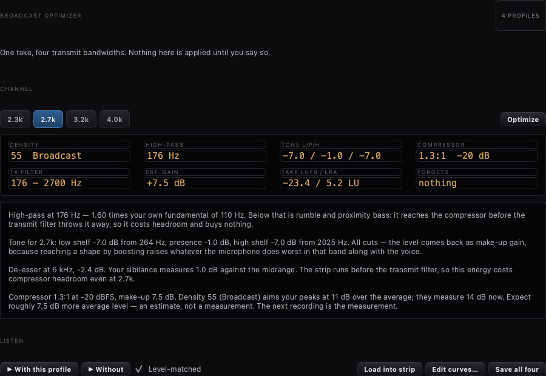

# Sendeton-Optimierer — vier Profile aus einem Durchgang

**Stand 2026-10-09.** Gebaut auf `feat/sendeton-optimierer`, Arbeitsbaum
`~/Longpath/worktrees/optimierer`. Läuft **neben** dem bisherigen
Stimmcheck, nicht an seiner Stelle.

---



*Oben das 2,7-k-Profil. [Das schmale 2,3 k](../images/optimierer-2300.png)
zeigt in „FORGETS" Roehre, Exciter und Nachhall;
[4,0 k mit einem Mikrofon, das bei 2,8 kHz schon unten ist](../images/optimierer-4000-warnung.png),
zeigt die Warnzeile. Alle drei aus `tst_broadcast_optimizer_panel`
gezeichnet — ohne Funkgeraet fuellt sich das Panel nicht.*

---

## Wie es ausging

Der Auftrag war ein Optimierer: fünfzehn Sekunden sprechen, daraus vier
fertige Profile. Einen Tag lang wurde das gegen Martins Stimme gefahren.
Fünf echte Fehler kamen dabei heraus und sind behoben — sie stehen
unten, weil jeder von ihnen etwas über diese Art Arbeit sagt. Der
Befund darunter blieb bestehen:

> „Das Original-Audio ist gut, nur sämtliche Bearbeitungen sind eine
> Katastrophe." · „also besser wird das audio nicht." ·
> **„ich glaube, wir lassen das automatische verbessern."**

Daraufhin umgebaut, auf Ansage und nach AetherSDRs Vorbild
(`~/Longpath/AetherSDR/src/gui/AetherialAudioStrip.cpp`):

> „bei aether konnte ich es allein sehr gut machen … schaue bitte, wie
> aether es gemacht hat. so werden wir es auch machen."

**Was der Unterschied war.** Aether zeigt alle Stufen gleichzeitig in
einem zweispaltigen Raster. Longpath zeigte eine Stufe je Reiter. Wer
von Hand einstellt, muss die ganze Kette sehen, während er an einer
Stufe dreht — sonst stellt er acht Dinge nacheinander ein und hört erst
am Ende, dass sie sich widersprechen.

Nebenbei richtiggestellt: **Aether kann Profile speichern.** Martin
erinnerte es anders; `ChannelStripPresets` hat Speichern, Laden,
Löschen, Export einzeln, Export der Bibliothek und Import.

---

## Was es jetzt ist

**Ein Übersichtsreiter „Strip"** vor den acht Stufenseiten, mit einer
Karte je Stufe: Name versal, Zustand als Kapsel, die drei Zahlen dieser
Stufe monospaced, ein Knopf in die volle Seite. Leserichtung = Ketten­
reihenfolge (Gate, EQ, De-Esser, Kompressor, Röhre, PUDU, Nachhall,
Begrenzer).

> Erster Versuch, verworfen: Longpaths Stufenseiten direkt ins Raster.
> Aethers Panels sind kompakt, Longpaths sind für eine ganze Reiterseite
> gebaut — allein das Gate bringt ein 280 px hohes Kennlinienfeld mit.
> Zwei Spalten davon erzeugten waagrechtes Scrollen und zeigten
> trotzdem eine Stufe. Im gezeichneten Bild gesehen, nicht am Gerät.

**Ein Messblatt** im Reiter „Voice check" — was die Aufnahme ergab,
nicht was daraus gemacht wird: Grundton, LUFS/LRA, Störabstand,
Zischfrequenz samt Pegel, der Punkt an dem das Mikrofon aufhört, und
der gewählte Kanal. Dazu je Breite ein paar Sätze, was das für sie
heißt.

**Vier Kanäle**, mit Martins Zahlen: Contest 200–2500, dann 150–2700,
100–3200, breit 50–4050. Unten liegt der größere Teil des Unterschieds
— 50 gegen 200 Hz sind zwei Oktaven Körper.

**Zwei Knöpfe zum Hören:** *Raw* spielt den Durchgang nur durch den
Kanal, *Through your strip* durch die eigene Einstellung und dann den
Kanal. Das A/B vergleicht also seine Arbeit mit dem Original, nicht
eine Herleitung mit seiner Arbeit.

**Ein Knopf zum Ablegen:** die Kette, wie sie gerade steht, unter dem
Namen dieser Breite. Das ist die ganze verbliebene Automatik, und sie
erfindet nichts.

---

## Die fünf Fehler, und was sie gemeinsam hatten

Alle fünf waren dasselbe: eine Entscheidung, für die die Messung nicht
trug.

1. **Eine Contest-Zielkurve für alle vier Breiten.**
   `VoiceAnalyzer::targetDb` verlangt 125 Hz bei −12 dB gegen 1 kHz.
2. **Überhaupt ein absolutes Ziel.** Das Spektrum einer Stimme fällt
   natürlicherweise; darauf zu zielen bügelt sie flach. Gemessen:
   8,3 dB Körper weg beim *breiten* Profil.
3. **Gestapelte Schnitte.** Hochpass beim 1,8-fachen des Grundtons
   (bei 110 Hz also 198 Hz, mitten in der Stimme) plus Tiefenfilter
   knapp darüber.
4. **Brummkerben auf dem Grundton.** Der Detektor summiert ±23 Hz um
   50/100/150/200 Hz; eine 110-Hz-Stimme legt Grundton und zweite
   Oberwelle hinein. Ohne jeden Brumm gemessen: 110 Hz −12,5 dB,
   150 Hz −17,6 dB, 220 Hz −3,7 dB. **Der Detektor ist unverändert —
   `StripTuner` hängt an derselben Funktion.**
5. **Stufen, die ungefragt mitliefen.** De-Esser klammerte auf
   mindestens 3 dB, lief also immer; Rauschsperre lief in jedem leisen
   Raum.

Dazu zwei Fehler im Hören selbst, die den Vergleich wertlos machten:
das Kanalfilter wurde beim Abhören gar nicht angewandt (alle vier
klangen gleich), und als es angewandt wurde, war es zweimal dieselbe
zweite Ordnung statt eines Butterworth vierter — −6 dB schon auf der
Ecke, Abfall eine Oktave darunter.

---

## Was aus der Zeus-Durchsicht blieb

Am Gerät abgelesen (siehe Gedächtnis-Eintrag). Übernommen und
geblieben: die **gemessene** Zischfrequenz statt einer festen, LUFS und
LRA als Maß, und die Erkenntnis, dass Zeus' drei Stile **keinen
Klangregler** anfassen. Nicht geblieben: alles, was daraus eine
Automatik machen sollte.

---

## Historie: der ursprüngliche Auftrag

Martin, 2026-10-09, in drei Nachrichten:

> „stimme analysieren, verbessern, optimieren, möglichkeiten aufzeigen und
> daraus resultierend ein 2,3 – 2,7 – 3,2 und 4 k Profil zu erstellen"

> „ziel ist es, vielleicht 15 sekunden zu sprechen ohne einstellungen als
> basis und daraus sollte dann sehr sorgfältig alles genauest automatisch
> analysiert werden, um ein bestmögliches profil zu bekommen. dieses kann
> man danach noch, sofern gewünscht abändern. daraus sollte dann auch
> gleich automatisch die anderen profile entstehen"

> „man könnte das parallel zu unserem bisherigen audio setup auch gestalten
> und später entscheiden wir oder wir verwenden das bisherige."

Dazu zwei Nachträge, die den Entwurf an zwei Stellen geändert haben:

> „zeus ist hier sicherlich mit allen seinen tools der maßstab"

> „zb bei contest muss auch diverse filter dann vergessen werden, die würde
> man dann eher ab 2,7 profil nutzen"

---

## Was schon dastand, und was wirklich fehlte

Der Baum hatte den größten Teil bereits:

| Vorhanden | Was es tut |
| --- | --- |
| `VoiceAnalyzer` | misst zehn Bänder, Rauschteppich, Scheitelfaktor, Brumm, Zischen, Übersteuerung |
| `StripTuner` | setzt daraus **eine** Kette |
| `StripTargets` | Zielkurven mit `topHz` |
| `StripSettings` | benannte Profile speichern/laden |
| `TxVoiceCheckDialog` | nimmt 15 s auf (roh **und** hinter dem Strip), spielt beide ab |

Es fehlte genau das Stück dazwischen: aus **einer** Messung **vier**
bandbreitenabhängige Profile ableiten, sagen, was jedes kostet, und jedes
einzeln hörbar machen.

---

## Zeus als Maßstab

Nachgesehen in `~/Longpath/zeus-station-engine` (v2.0.26). Zwei Befunde,
beide übernommen:

**1. Ein Profil trägt den Kanal mit.** `TxAudioProfileDto`
(`Zeus.Contracts/Dtos.cs:2944`) ist „a single operator-named macro that
captures the ENTIRE TX-audio shaping state" — und führt `LowCutHz` /
`HighCutHz` neben der Kette. Ein „2,3 k Profil", dessen Sendefilter noch
auf 2,7 kHz steht, ist keines. `Plan` trägt beide Werte deshalb mit.

**2. Eine Dichte-Achse statt Verhältnis und Schwelle.**
`TargetSpectralDensity`, ganzzahlig 0..100, Vorgabe **55**
(`Station.Engine.Hosting/TxFidelityPolicyStore.cs:DefaultTargetn`). Das
ist die bessere Bedienung und ist unverändert übernommen: der Bediener
bewegt **eine** Zahl, der Kompressor wird daraus *gerechnet*.

Die Benennung der Stufen (Natural / Broadcast / Dense / Maximum) steht im
Zeus-Client, nicht im Maschinen-Quelltext. Die Zahlen dahinter sind
Longpaths eigene Setzung auf Zeus' Skala — Broadcast liegt auf Zeus'
dokumentierter Vorgabe 55, der Rest verteilt sich darum.

---

## Über den Tellerrand: was die Musikbranche hergibt

Gesucht nach frei verwendbaren Bausteinen. Drei Befunde, einer davon
eingebaut, zwei als Vorschlag offen.

### Eingebaut: LUFS und LRA (BS.1770 / EBU Tech 3342)

`src/core/Loudness.{h,cpp}`, Longpath-eigen, kein fremder Quelltext.

Der Analysator hatte drei hausgemachte Pegelzahlen, von denen zwei
dasselbe maßen und keine außerhalb des Programms etwas bedeutete. Der
Hausstil sagt dazu das Nötige: *zwei Zahlen für eine Rolle sind schlimmer
als die falschere von beiden.* Also:

* **LUFS** — K-gewichtete Lautheit mit dem zweistufigen Tor.
* **LRA** — Lautheitsumfang, der Normmaßstab für „wandert der Pegel".

Der Gewinn ist nicht die Norm an sich, sondern dass **vorher und nachher
vergleichbar** werden: denselben Durchgang durch ein Profil rechnen, neu
messen, und die LUFS-Differenz *ist* der gewonnene Durchschnittspegel,
während die LRA-Differenz zeigt, was es an Leben gekostet hat. Ein
Scheitelfaktor kann das nicht, und das Ohr kann es nicht zweimal
zuverlässig.

Die K-Gewichtung wird aus den zeitkontinuierlichen Entwurfsgrößen per
Bilineartransformation **gerechnet**, nicht als 48-kHz-Tabelle
abgeschrieben — so arbeitet der Analysator bei jeder Abtastrate. Der
Prüfstand stellt die Ableitung gegen die veröffentlichte 48-kHz-Tabelle:
träfe sie die fünf Zahlen nicht, wäre entweder die Transformation oder
eine der vier Entwurfskonstanten falsch.

> Die Entwurfsgrößen stammen aus Zweitquellen (veröffentlichte Tabelle,
> Umsetzungen, die sie herleiten); das ITU-Papier ist kostenpflichtig.
> Der Tabellenabgleich ist die stärkste Prüfung, die ohne das Papier
> möglich ist.

### Vorschlag, noch nicht eingebaut: Airwindows `ClipOnly2`

MIT, Chris Johnson. Ein Begrenzer kappt, ein **Clipper** schert ab — und
in einer Rundfunkkette steht der Clipper ganz am Ende. `ClipOnly2`
unterdrückt dabei die Helligkeit des digitalen Clippens, ohne
unbeschnittene Abtastwerte anzufassen; der Zustand dafür ist winzig (ein
letzter Abtastwert und zwei Marken je Kanal). Clippt bei ±0,9549925859,
also rund −0,2 dB, ohne Regler.

Offen, weil es **Herunterladen** von fremdem Quelltext heißt und das
Martins Entscheidung ist. Längst nicht jede Airwindows-Datei lohnt — die
meisten wären Doppelungen zu `ClientComp` und `ClientDeEss`. Diese eine
schließt eine echte Lücke.

### Vorschlag, noch nicht eingebaut: Mehrband

NU9N ist hier unbequem deutlich und spricht gegen den naheliegenden
Wunsch:

> broadcast processors „are not specific enough unless you are
> transmitting at 6 kHz of audio bandwidth or more. Their flexibility is
> very limited below 6 kHz." — <https://www.nu9n.com/tx.html>

Bei 2,3 bis 4,0 kHz ist ein echter Optimod-Mehrbänder also eher Aufwand
als Gewinn. WDSP bringt mit CFC ohnehin schon einen zehnbandigen
Dichteregler mit, den Longpath bereits bedient. **Empfehlung: nicht
bauen**, bis jemand breiter als 6 kHz sendet.

---

## Was ein Profil ist — nach dem Umbau vom selben Tag

**Dynamik. Kein Entzerrer.** `apply()` fasst die Klangregelung nicht
an: nicht gesät, nicht ein-, nicht ausgeschaltet, nicht gelesen. Die
Kurve des Bedieners bleibt, wie sie ist.

Das ist Zeus' Form, am 2026-10-09 am laufenden Gerät abgelesen. Seine
drei Stimmstile sind je drei Angaben:

| | |
|---|---|
| NATURAL | Expander −40 dB (SNR 28 dB), trim +9,5 dB auf −20 dBFS, AGC −22 |
| BROADCAST | Expander −38 dB (SNR 28 dB), trim +9,5 dB auf −20 dBFS, breit auf 2,9 kHz |
| DX PUNCH | Expander −38 dB (SNR 28 dB), trim +9,5 dB auf −20 dBFS, Komp 4:1 |

Expander aus dem gemessenen Störabstand, ein Pegeltrimm auf ein festes
Ziel, genau **eine** kennzeichnende Änderung. Kein Klangregler.

Longpath macht es ebenso:

| Stufe | Woher |
|---|---|
| Expander | Schwelle = Rauschteppich + 0,65 × Störabstand, Boden −8 dB |
| Trimm | auf −20 dBFS, als Drive **vor** dem Kompressor |
| De-Esser | auf der gemessenen Zischfrequenz (`VoiceAnalysis::sibilanceHz`) |
| Kompressor | Verhältnis = gemessener Scheitelfaktor ÷ angezielter (Dichte) |
| Phasendreher | 8 Stufen — Zeus' gemessene Wahl an derselben Stimme |
| Breite | **ist** die kennzeichnende Änderung |

Je Breite unterscheiden sich nur Dichte, Kompression, die Breite selbst
und ob die Farbstufen laufen:

| Breite | Dichte | Farbstufen |
| --- | --- | --- |
| 2,3 k | 75 Dense | **aus** |
| 2,7 k | 55 Broadcast | an |
| 3,2 k | 42 | an |
| 4,0 k | 40 Natural | an |

### Warum der Entzerrer draußen bleibt

Die erste Fassung leitete je Breite einen Hochpass, zwei Kuhschwänze
und eine Präsenzglocke ab. Das Urteil nach dem Hören war eindeutig:

> „Das Original-Audio ist gut, nur sämtliche Bearbeitungen sind eine
> Katastrophe." · „hier ist kein Bass, hier fehlt es einfach an allem."

Vier Fehler, alle derselben Art — Code, der an einem Klangregler dreht,
für den die Messung nicht trägt:

1. **Eine Contest-Kurve für alle vier Breiten.** `VoiceAnalyzer::targetDb`
   verlangt 125 Hz bei −12 dB gegen 1 kHz.
2. **Überhaupt ein absolutes Ziel.** Das Spektrum einer Stimme fällt
   natürlicherweise; 250 Hz liegt bei jeder Stimme weit über 1 kHz.
   Darauf zu zielen bügelt die Neigung flach — gemessen 8,3 dB Körper
   weg beim *breiten* Profil.
3. **Gestapelte Schnitte.** Hochpass beim 1,15- bis 1,8-**fachen** des
   Grundtons (bei 110 Hz also 198 Hz, mitten in der Stimme) und direkt
   darüber ein Tiefenfilter auf dieselbe Gegend.
4. **Die Brummkerbe auf dem Grundton.** `VoiceAnalyzer` summiert ±2
   FFT-Bins um 50/100/150/200 Hz — bei 4096 Punkten und 48 kHz rund
   ±23 Hz. Eine Männerstimme mit 110 Hz legt ihren Grundton in das
   Fenster um 100 Hz und ihre zweite Oberwelle in das um 200. Der
   Detektor meldete Brumm, der nicht da war, und die Kerben nahmen das
   Fundament heraus. Gemessen ohne jeden Brumm: 110 Hz −12,5 dB,
   150 Hz −17,6 dB, 220 Hz −3,7 dB.

Der Detektor selbst ist unverändert — `StripTuner` hängt an derselben
Funktion, das wäre eine eigene Änderung mit eigener Gegenprobe. Der
Optimierer folgt ihm nur nicht mehr.

## Hören, ohne zu entscheiden

Die vier Profile stehen in keiner Kette, also gibt es keinen Abgriff
hinter dem Strip, von dem sie aufzunehmen wären. Sie werden **gerechnet**:
der rohe Durchgang kopiert, durch eine Wegwerf-`StripChain` mit dem Plan
geschoben, aus dem Speicher abgespielt — wie die beiden anderen
Wiedergaben, abseits des Echtzeitpfades.

Je Tastendruck eine frische Kette. Eine wiederverwendete trüge mit, was
der vorige Plan hinterlassen hat, und genau das würde ein A/B zwischen
zwei Profilen zum Vergleich der falschen zwei Dinge machen.

„Ohne" liegt daneben: derselbe Durchgang, unbehandelt, einen Klick
entfernt.

---

## Was der Optimierer nicht tut

* **Nichts anwenden.** `plan()` ist eine reine Funktion der Messung,
  `saveAsPresets()` schreibt benannte Profile. Die Kette ändert sich erst,
  wenn der Bediener eines auswählt. Genau das macht den Parallelbetrieb
  zum bisherigen Weg möglich.
* **Den Hauptschalter nicht anfassen.** Wie überall in `core/strip/`.
* **Das Sendefilter nicht stellen.** Der Plan *trägt* `lowCutHz` /
  `highCutHz` und zeigt sie an; gestellt wird es von dem, der den Plan
  anbietet — sichtbar und mit Absicht. Die WDSP-Sendebandbreite gehört
  `TransmitModel` und ist von `core/strip/` aus bewusst nicht erreichbar.
* **Nichts versprechen.** Jeder Plan nennt seine Kosten, und einer, der
  sich nicht lohnt, sagt das in `caveat`. Ein 4-kHz-Profil aus einem
  Mikrofon, das bei 3,1 kHz schon 20 dB unten ist, ist ein leeres
  Versprechen — und die neue Abfallmessung sieht das.

---

## Prüfstand

`tests/tst_broadcast_optimizer.cpp`, 12 Fälle. Die beiden, auf die es
ankommt:

* **Die K-Gewichtung gegen die veröffentlichte 48-kHz-Tabelle.** Die
  Ableitung muss die fünf Zahlen je Stufe treffen; zufällig geht das
  nicht.
* **Die vier Profile unterscheiden sich wirklich, und in der behaupteten
  Richtung.** Eine Breitentabelle so zu verdrahten, dass jede Zeile
  dieselbe Kette erzeugt, ist das Leichteste der Welt — und sähe im
  Fenster völlig plausibel aus.

Dazu: Lautheit folgt der Verstärkung auf 0,01 dB, LRA sieht die 10-dB-Stufe
und sieht beim Dauerton keine, Stille ist keine Messung, zweimal Anwenden
lässt nichts stehen, der Hochpass folgt der Tonhöhe und bleibt im Deckel,
übersteuert/ungültig wird verweigert.

---

## Offen

* **Live am Gerät noch nicht gesehen.** Bau und Prüfstand ja, ein
  Durchgang mit echter Stimme nein.
* **`ClipOnly2` und der Mehrbänder** — siehe oben, beides Martins
  Entscheidung.
* **Die Stufenzahl des Phasendrehers je Stimme suchen.** Zeus misst sie
  („8 stages measured best") und meldet sie als eine begrenzte
  Änderung mit UNDO daneben; wir nehmen seine 8. Dafür braucht es die
  Aufnahme, die `plan()` nicht hat — ein eigener Schritt.
* **Dichte von Hand verstellen.** Die Achse ist da und wird angezeigt,
  aber noch ohne Regler: `Plan::density` ändern und neu rechnen wäre
  wenige Zeilen. Bewusst nicht mitgebaut, bis die vier Vorgaben an einer
  echten Stimme gehört wurden — sonst ist es ein Regler für eine Skala,
  die noch niemand beurteilt hat.
* **Die vier Dichte-Stufenwerte** sind Longpaths Setzung, nicht Zeus'.
  Wenn Zeus Link sie sichtbar macht, nachziehen.

---

# Nachtrag 2026-10-09, Abend: Werkbank statt Automatik

Vier Wünsche in Folge, alle am selben Abend, alle in dieselbe Richtung.
Sie gehören zusammen und ergeben erst zusammen etwas: aus einem
Fenster, das Profile *herleitet*, ist eine Werkbank geworden, an der
man eine Stimme von Hand einstellt und dabei hört und sieht, was man
tut.

## 1. Der Kanalzug hängt nicht mehr an der Sendepumpe

`m_stripChain` entstand in `connectToRadio()` und starb in der
Teardown. Ohne Verbindung war das ganze Fenster tot — Hauptschalter
ohne Wirkung, acht Stufenseiten ohne Werte, Übersichtskarten mit acht
Strichen, „Through your strip" im Stimmcheck durch gar nichts. Am
Gerät, mit offenem Fenster: *„kann diese nicht aktivieren."*

Jetzt `RadioModel::ensureStripChain()` im Konstruktor. Beim Pumpenstart
nur noch `prepare()` (löscht Filterzustände, lässt Einstellungen
stehen) und die Übergabe an den Worker; in der Teardown wird er nicht
mehr gelöscht. Die Reihenfolge stimmt weiter, weil er **vor**
`m_txWorker` deklariert ist und Mitglieder in umgekehrter Reihenfolge
sterben.

Das war kein Versehen in einer Zeile, sondern eine falsche Annahme:
eine Stimme stellt man am Schreibtisch ein, nicht auf Sendung.

## 2. Mithören, Fassung 2

Das Häkchen „Hear myself" flog am 2026-08-11 hinaus (49d10dc8), und der
Grund war gut: sein Weg hing am Mikrofonstrom des **Funkgeräts**, und
dessen eigene Taktmessung zeigte 3190–3639 Pumpentakte je 5 s, wo 3755
hingehören — 3 bis 15 % verlorene Blöcke. Ein Sample, das nie ankam,
lässt sich nicht zurückpuffern.

`src/core/strip/StripLiveMonitor.{h,cpp}` berührt das Gerät nicht:

    Soundkarte ein → eigener StripChain → Soundkarte aus

Ein Taktgeber, der des Rechners, keine Netzstrecke — genau der Grund,
aus dem AetherSDRs Kette nie stotterte.

**Eigener Kanalzug, nicht der der Sendekette.** Dessen Stufen halten
Filterzustände, und die Sendepumpe läuft darauf auf ihrem Faden; zwei
Audiofäden in denselben Zuständen sind ein Datenrennen, das nur im
Betrieb und nur manchmal knackt. Gehört wird trotzdem dasselbe, weil
der Mithör-Kanalzug aus derselben gespeicherten Einstellung
wiederhergestellt wird: `persist()` deckt die 49 Stellen ab, die durch
dieses Fenster gehen, ein halbsekündiger Takt die, die es nicht tun
(der portierte Entzerrer speichert über `EqHost` selbst).

**Eigener Faden, hoch eingestuft.** Am Bedienfaden bestimmen
Zeichenarbeit und 100-ms-Zeitgeber die Antwortzeit. Ohne Elternobjekt,
und das ist der Punkt, an dem so etwas sonst stillschweigend misslingt:
Qt verschiebt kein Objekt, das an einem Elternobjekt auf einem anderen
Faden hängt.

### Die Latenz, und was daran schiefging

Erst 256 Rahmen und drei Blöcke Vorrat, rund 21 ms. Auf die Ansage
*„arbeite auch daran, dass latenz noch geringer wird"* halbiert auf
128/2 und „8 ms" genannt — woraufhin im Kopfhörer **komplettes
Krachen** stand, ohne dass der Betreiber irgendetwas getan hätte.

Das war dieselbe Fehlerform wie am Vormittag: eine Zahl ohne tragende
Messung. Wie knapp ein Rechner laufen kann, hängt an seinen Geräten,
seinen Treibern und daran, was sonst läuft.

Drei echte Fehler steckten mit drin:

| Fehler | Warum er knackt |
|---|---|
| Zwei Blöcke Vorrat | Einer wird ausgegeben, einer ist unterwegs — erst der dritte ist Vorrat |
| Ausgabepuffer = gewollter Vorrat | `write()` schneidet mitten im Block ab; ein angeschnittener Block knackt lauter als ein ganzer, der fehlt |
| Ausgang fing leer an | Unterlauf beim ersten Ton — das Knacken bei jedem Start, unabhängig von der Puffergröße |

Jetzt: Puffer acht Blöcke groß (write() schneidet nie ab), gesteuert
wird über den **stehengebliebenen** Vorrat, Start mit zwei Blöcken
Stille, bei Unterlauf eine halbe Blocklänge Stille nachlegen, bei
Überlauf einen **ganzen** Block fallen lassen. Und die Stufe wählt der,
der es hört: **Safe / Low / Lowest**, Vorgabe Safe, mit dem Zähler
daneben.

## 3. Die Entzerrerkurve zeigt die eigene Stimme — und hält sie

Der Peak-Hold-Knopf war längst da, portiert mit Aethers Entzerrer. Was
fehlte, war das Spektrum darunter: `StripChain::micSpectrum()` füllte
allein die Sendepumpe. Jetzt schreibt der Mithörer das **rohe**
Mikrofonsignal mit hinein — roh, weil `EqHost` die Kurve bewusst über
ein Spektrum **vor** dem Entzerrer legt.

Dann: *„die eigene kurve sollte auch längere zeit mit hold stehen
bleiben und standhaft bleiben."* Nachgesehen, wie Aether es macht — er
ist hier der Maßstab. Ergebnis: `AetherSDR/src/gui/ClientEqCurveWidget.cpp:118-125`
ist wortgleich das Portierte und tut **nicht**, was der Name
verspricht:

```cpp
const float decayStep = m_peakHoldFrozen ? 0.0f : kPeakDecayDb;
m_peakHoldDb[i] = std::max(decayed, m_fftBinsDb[i]);
```

Eingefroren hält dort nur der Abfall an; das Maximum wird weiter
nachgezogen. Jedes Geräusch hebt die Linie weiter an, und weil sie nie
wieder fällt, ist sie nach einer Minute nicht mehr die Stimme, sondern
die Höchstmarke von allem, was seither im Zimmer passiert ist. Ein
Bezug, der sich unter der Hand ändert, ist schlimmer als keiner.

Longpath-Abweichung, beide Richtungen:

* **eingefroren** — es wird nichts mehr angefasst, auch die Größe
  nicht (ein Ratenwechsel während des Haltens hätte die Linie sonst
  gelöscht).
* **frei** — je Fach zwei Sekunden halten, dann mit 3 dB/s fallen.
  Upstream fiel mit 12,5 dB/s: wer einen Satz spricht und danach
  **hinsieht**, sah nichts mehr.

Gegenprobe gegen Aethers Fassung gefahren: eingefroren zieht sie dort
von −40 auf −20 nach, frei steht nach einer Sekunde statt −20 nur noch
−32,5 dB.

## 4. Einschübe für fremde Effekte — als Zusatz, nie als Weg

Die Ansage, wörtlich, weil sie jede spätere Änderung bindet: *„will das
unabhängig machen […] plugins können nur als option zusätzlich gelten,
wenn gewollt. ist nicht der standard."*

Drei Regeln, in `core/strip/AudioPlugin.h` festgehalten:

1. **Leer ist der Normalfall.** Kein Suchlauf beim Start, kein Reiter,
   der sich aufdrängt, keine Rechenzeit. Ein leerer Platz kostet im
   Block eine atomare Ladung.
2. **Ein fehlendes Plugin ist kein Fehler.** Auf einem Rechner ohne
   dieses Plugin bleibt der Platz leer und die Kette klingt wie ohne
   ihn. Keine Warnung, keine Sperre.
3. **Fremder Code steht unter demselben Verdacht wie der
   Mikrofoneingang** — nur stärker: er ist das einzige Stück dieser
   Kette, das wir nicht gelesen haben. Liefert er etwas, das keine Zahl
   ist, bekommt die Kette den Block zurück, wie er hereinkam, das
   Plugin wird zurückgesetzt, der Vorfall gezählt.

**Audio Units zuerst**, nicht VST3: AU ist auf dem Mac Systemsache —
kein fremdes SDK im Baum, kein zweites Lizenzverhältnis, eine
C-Schnittstelle, die seit zwanzig Jahren steht. VST3 ist seit Ende 2025
MIT-lizenziert (SDK 3.8.0) und kommt damit für Windows und Linux
daneben, nicht an diese Stelle. Auf anderen Plattformen übersetzt der
Wirt zu drei leeren Antworten, und `available()` sagt „hier gibt es das
nicht" — was etwas anderes ist als „hier ist nichts installiert".

**Keine fremde Oberfläche.** Die Parameter werden ausgelesen und in
unseren Reglern gezeichnet. Das ist die Entscheidung, nicht der
Notbehelf: es hält den Hausstil, läuft plattformgleich und umgeht das
Einbetten fremder Ansichten in Qt, an dem solche Vorhaben üblicherweise
scheitern. Der Preis gehört genannt: ein Plugin, dessen Können in
seiner Oberfläche steckt, ist hier eine Liste von Zahlen.

**Der Austausch im Betrieb.** Audiofaden setzt `busy`, *dann* liest er
den Zeiger. Hauptfaden leert den Zeiger, *dann* wartet er auf
`busy == 0`. Danach kann kein Durchlauf das alte Plugin mehr in die
Hand bekommen. Kein Schloss — der Audiofaden darf nie blockieren, also
dreht der Hauptfaden die Schleife.

**Zwei Plätze, Stelle frei wählbar** (0 = vor dem Gate,
`kStageCount` = hinter dem Begrenzer). Nicht eine neunte Stufe: ein
Kompressor vor dem Entzerrer ist ein anderes Gerät als einer dahinter,
und das gehört dem gewählt, der es hört.

### Hineinziehen statt einstellen

*„wichtig ist, dass man weiß, wo man diese einbauen soll […] diese
sollte man dann in der timeline oben reinziehen können. aber relativ
leicht auch wieder löschen."*

Die Reihe oben **ist** die Kette: Fuge, Stufe, Fuge, Stufe — und wo ein
Einschub hängt, steht seine Kachel statt der leeren Fuge. Beim Ziehen
leuchtet die Fuge auf, auf die es fällt. Gezielt wird auf die
nächstgelegene Fuge, nie auf eine Stufe: wer über der Mitte des
Kompressors loslässt, meint nicht „in den Kompressor hinein". Die
Kachel ist gestrichelt (dieselbe Zusage wie beim Plus) und trägt ein
Kreuz rechts oben.

`core/strip/PluginPlacement.{h,cpp}` gruppiert den Katalog nach dem
Platz, an den das Plugin gehört — mit einer Warnung im Klartext: das
ist **geraten**. Eine Audio Unit nennt ihre Gattung nicht. Geraten wird
mit Netz (Wortstämme), und was nicht zuzuordnen ist, landet sichtbar
unter „noch nicht eingeordnet" statt stillschweigend in der erstbesten
Gruppe — ein falsch einsortiertes Plugin wäre schlimmer als ein nicht
einsortiertes, weil es etwas behauptet.

### Das Loch, das beim Durchdenken auffiel

Der Mithörer hat seinen eigenen Kanalzug und damit eine eigene Instanz
desselben Plugins. Die blieb auf dem Stand vom Laden: man hätte an
einem Plugin-Regler gedreht und nichts gehört — also wäre das Mithören
genau dort nutzlos gewesen, wo es gebraucht wird.
`StripChain::applyInsertState()` nimmt den gespeicherten Zustand an,
**wenn er sich geändert hat**, mit demselben Handschlag. Der Vergleich
davor ist Pflicht, nicht Geiz: ohne ihn hielte der halbsekündige
Abgleichtakt zweimal je Sekunde den Audiofaden an.

## 5. Das Plus, angesehen statt behauptet

*„vergesse nicht auf das rendering des + für das hinzufügen der
widgets."*

Es war ein `QPushButton` mit einem „+" und einem gestrichelten Rand aus
dem Stilblatt; jetzt malt es sich selbst. Was es **nicht** geworden
ist: ein hüpfendes Zierstück. Der Hausstil hat zu Bewegung genau einen
Satz, und der ist eine Grenze — *„Zustandswechsel: 150 ms ease. Nichts
springt."* Also bewegt sich nichts von selbst; bewegt wird nur, was
etwas aussagt: offen dreht es sich in 180 ms um 45 Grad und steht als
Kreuz da (Regel 5 in Bewegung), Zeiger darauf 150 ms, Druck 90 ms.
Dazu die Zusage, die ein Kreuz macht — derselbe Knopf schließt wieder,
und ein Ereignisfilter dreht zurück, wenn der Auswähler an uns vorbei
zugeht.

Selbst gemalt aus zwei Gründen: drehen lässt sich ein Textzeichen im
Stilblatt nicht, und der geerbte Innenabstand aus `Style::kButtonStyle`
— der genau diesem Knopf schon einmal fast das Zeichen weggefressen
hätte — kann in einem eigenen `paintEvent` gar nicht mehr zuschlagen.

**Am Bild nachgebessert, dreimal, und keines davon beim Lesen des Codes
sichtbar:** offen und „Zeiger darauf" trugen dieselbe Fläche aus
`kButtonBg`, die so dicht am Grund liegt, dass kein Unterschied zu sehen
war (jetzt der gedeckte Auswahlverlauf `kGlassSel*`, Hausstil Regel 2);
die Einschubkachel klebte an der Stufe davor; und vor der ersten Stufe
stand ein Kettenzeichen, das „fließt hinein" heißt.

`tst_plus_glyph_renders` und `tst_strip_chain_row_drops::theRowIsOnFile`
legen die Bilder ab (`LONGPATH_RENDER_DIR`) **und** halten fest, dass
die Zustände überhaupt verschieden aussehen — eine Zustandsanimation,
die in jedem Zustand dasselbe Bild liefert, ist keine, und das merkt
niemand, wenn nur die Mechanik geprüft wird.

## Prüfstände dieses Abends

| | |
|---|---|
| `tst_strip_works_without_radio` | 4 Fälle; Gegenprobe: 3 fallen ohne die Behebung |
| `tst_strip_plugin_inserts` | 8 Fälle; findet auf dieser Maschine 26 Audio Units, lädt die erste und schickt Ton hindurch |
| `tst_eq_peak_hold_stands_still` | 2 Fälle; Gegenprobe gegen **Aethers** Fassung: beide fallen |
| `tst_plugin_placement` | 6 Fälle |
| `tst_strip_chain_row_drops` | 6 Fälle, darunter einer, der jeden Punkt der Reihe durchgeht |
| `tst_plus_glyph_renders` | 3 Fälle |
| `tst_widget_picker` | + `theSameButtonClosesWhatItOpened` |

## Was offen bleibt

* **Live noch nicht gehört.** Gebaut, geprüft, gerendert — aber die
  Werkbank hat noch niemand benutzt.
* **CoreAudio von Hand** für das Mithören: zwei AUHAL-Einheiten mit
  einem Ring dazwischen. Erst damit ließen sich
  `kAudioDevicePropertyLatency` und der SafetyOffset der Geräte ablesen
  und die angezeigte Zahl wäre die ganze Wahrheit statt nur unseres
  Anteils.
* **VST3 für Windows und Linux.** Die Schnittstelle ist dafür gebaut;
  es fehlt der zweite Wirt.
* ~~**Der Brummdetektor** hält bei einer 110-Hz-Stimme den Grundton für
  Netzbrumm.~~ **Behoben**, noch am selben Abend — siehe unten.

---

## Nachtrag: der Brummdetektor, behoben

Der letzte offene Defekt vom Vormittag, und der einzige, den ich
damals stehen ließ, weil `StripTuner` daran hängt.

Gemessen am Gerät: eine Männerstimme mit rund 110 Hz Grundton wurde
als „Netzbrumm, 12,5 dB unter der Stimme" gemeldet, woraufhin
`StripTuner` 50, 100 und 150 Hz mit bis zu −18 dB auskerbte — also den
Grundton und die zweite Oberwelle der Stimme selbst.

Die Ursache ist Arithmetik: die Brummfenster sind ±2 Fächer breit,
bei dieser FFT-Länge rund 23 Hz. Das 100-Hz-Fenster reicht von 77 bis
123 Hz und fängt jede Stimme dazwischen.

**Zwei verschieden weite Abstandsregeln**, und der Unterschied ist
gemessen, nicht geschätzt:

| | Abstand | warum |
|---|---|---|
| Oberwellen der Stimme | 2,5 Fächer (~29 Hz) | die Fensterbreite selbst reicht |
| **Grundton** | 8 Fächer (~93 Hz) | er ist das Lauteste im Spektrum, und die Silbenflanken verschmieren seine Linie weit nach unten: bei 110 Hz liegt das 63-Hz-Band nur rund 23 dB unter ihm |

Mit der engen Regel allein meldete der Detektor bei 110 Hz weiter
−9,5 dB „Brumm", wo keiner ist. Mit der weiten sperrt eine
110-Hz-Stimme das 50-Hz-Fenster, eine 210-Hz-Stimme (160 Hz entfernt)
gibt es frei.

Ist das **erste** Fenster gesperrt — das, in dem Netzbrumm lebt —,
gibt es keine Messung: `humMeasurable = false`, `humDb = −120`.
Hausstil Regel 7. Eine Zahl, die man nicht verteidigen kann, ist
schlimmer als keine; auf genau so eine Zahl hin wurde gekerbt.

Zwei Folgefunde:

* **Die Brummmessung läuft ein zweites Mal, nach der Tonhöhe.** Der
  erste Durchgang steht vor ihr, dort war `r.pitchHz` null und der
  Wachhund wirkungslos. Der eigene Prüfstand hätte sonst grün
  gemeldet, ohne etwas zu prüfen — er fiel an der Zeile, die prüft,
  dass die Stimme überhaupt ein Fenster belegt.
* **`StripTuner` lässt einzelne Kerben aus,** die auf einer Oberwelle
  sitzen. Bei 210 Hz Grundton fällt die 200-Hz-Kerbe praktisch darauf,
  auch wenn das erste Fenster sauber war.

`tst_hum_is_not_the_voice` prüft beide Richtungen: die tiefe Stimme
ohne Brumm, und — ebenso wichtig — eine hohe Stimme **mit** echtem
50-Hz-Brumm, der weiter gefunden werden muss. Ohne den zweiten Fall
wäre „keine Brummmeldung mehr" trivial zu erreichen und wertlos.

Der Prüffall selbst musste zweimal nachgebessert werden, und beide
Male lag es am Generator, nicht am Detektor: hart geschaltete Silben
sind Knalle mit Energie bei 50 Hz, und eine Kunststimme mit
Oberwellen nur bis 1,5 kHz hat nichts zwischen 1 und 3 kHz — genau
dort, wogegen der Brummwert gemessen wird. Das ist der Grund, warum
ein Prüfstand mit synthetischem Material einen eigenen Durchgang
Misstrauen verdient.

---

## Nachtrag 2026-10-13: Aethers Kanalzug wird die Grundlage

> „mein headset funktioniert mit windows und dem aether channel strip,
>  also die einstellungen bei eather perfekt! wir müssen unsere grafik
>  verwenden, aber alle einstellungen usw. von aether verwenden."

Damit ändert sich die Richtung dieses Blattes an einer Stelle: die
Werte kommen nicht mehr aus eigener Herleitung, sondern aus einer
Datei, die der Betreiber unter Windows an seinem Teufel-Headset fertig
eingestellt hat. Unsere Aufgabe ist, sie **unverfälscht** zu
übernehmen — und zu sagen, wo das nicht geht.

### Warum das überhaupt möglich ist

Die acht Stufen sind aus AetherSDR portiert und rechnen Zeile für
Zeile dasselbe. Sechs Leser haben beide Quellen Parameter für
Parameter verglichen (AetherSDR `d58e2b8a` gegen unseren Baum); von
rund sechzig Werten sind alle 1:1 übernehmbar außer sieben, und die
sieben stehen als Kommentar an genau der Stelle im Importeur, an der
der Unterschied gemacht wird (`core/strip/AetherPreset.cpp`).

### Die eine Änderung am Unterbau: die Reihenfolge

Aether trägt die Kette als **Liste** (`"chain"`), und die Liste ist
zugleich Reihenfolge und Tor: was nicht darin steht, läuft gar nicht
(`AudioEngine.h:482-483`). Longpath hatte die Reihenfolge als feste
Folge von Aufrufen in `processMono()`.

Martins Kette stellt die Röhre **vor** das Tor. Das ist kein
Geschmack, sondern ein anderes Gerät — gemessen, dieselben zwei
Stufen, dieselben Werte, nur getauscht:

| | RMS |
| --- | --- |
| Kompressor → Röhre | 0,9138 |
| Röhre → Kompressor | 0,2373 (−11,7 dB) |

`StripChain` hält die Reihenfolge seither in **einer atomaren Zahl**
(zehn Stufen zu je vier Bit). Der Audiofaden liest sie einmal je
Block; der Hauptfaden schreibt sie in einem Zug. `setStageOrder()`
nimmt nur eine vollständige Permutation an. Gespeichert wird sie als
Liste von Wörtern, nicht als Zahlen.

Die Einschubplätze bedeuten weiterhin „vor der Stufe an Stelle i",
nicht „vor einer bestimmten Stufe" — ein Platz ist eine Stelle in der
Kette, kein Anhängsel einer Stufe.

### Was der Vergleich mit einem perfekten Filter ergeben hat

„bei 4000 hört sich das alles nicht besonders an, bei roh ist das eine
ganz andere liga." Gemessen gegen einen idealen linearphasigen Kanal
(2047 Koeffizienten, dieselben Ecken) ist unser IIR-Kanal im
Durchlassbereich **nicht unterscheidbar** (höchste Abweichung 0,84 dB,
und die sitzt bei 63 Hz am Hochpass; von 125 Hz bis 4 kHz sind es
Hundertstel). Der Unterschied gehört der Bandbreite.

Damit ist auch entschieden, was NICHT gebaut wird: ein linearphasiges
FIR-Filter für den Kanal würde 21 ms feste Laufzeit kosten und im Band
nichts verbessern.

Ein Teil des Unterschieds ist allerdings hausgemacht und liegt im
Profil: sein Kuhschwanz sitzt bei 4982 Hz, also über der Kanalgrenze.
Deshalb liegt neben seiner Kette eine zweite mit genau diesem einen
Zug anders (3400 Hz) — zum Hören, nicht als Behauptung.

---

## Nachtrag 2026-10-14 — der Tag, an dem vier Messgeräte gelogen haben

Ein ganzer Tag am Gerät, mit dem Betreiber am Kopfhörer. Er hat
viermal den Kopfhörer abreißen müssen, zuletzt um 21 Uhr („muss
sofort abdrehen und longpath zu machen"). Keiner dieser Vorfälle war
eine kaputte Einstellung. Alle vier waren Instrumente, die etwas
anderes anzeigten als das, was geschah — und die Behebungen stehen
deshalb unter einer gemeinsamen Überschrift.

### Was gemessen wurde, und was dabei herauskam

| Fund | Zahl |
| --- | --- |
| „Übernehmen" rechnete mit der Spitze des letzten Blocks | in einer Sprechpause −48 dBFS → **+36 dB** gesetzt |
| CoreAudio legt einen Mehrkanalwandler selbst zusammen | 16 Eingänge → **−24 dB** auf die Stimme |
| Apollo-Eingang 3/4 trägt Longpaths **eigenen Ausgang** | −13,7 / −13,7 dBFS, auf die Nachkommastelle |
| Mithörprotokoll zeigte die Spitze eines Häppchens | „−50 dBFS" neben „Kanal 1: −1,3 dBFS", dieselbe Sekunde |
| Eingangszeile behielt den Zeigerstand bei ausgeschalteter Kette | „0,0 dBFS · 12 dB zu viel", während −55 ankamen |
| Jede Voreinstellung endet am Begrenzer, roh liegt weit darunter | **20 bis 40 dB** Sprung beim Umschalten |
| Clipper, Zweitonversuch | 6 dB → −45,1 dB IMD, **9 dB → −22,6 dB** |
| Clipper, Dichte bei gleicher Lautheit | 12 dB kauft 3,1 dB — und kostet 16 % Fremdanteil |
| Welche Stufe Wörter abhackt | **nur das Gate**: 68 Löcher, alle anderen 0 |
| Gate: welcher Griff hilft | Schwelle −37 → **−45 dBFS**: 72 → 5 Löcher |

### Was daraus gebaut wurde

* **`StripChain::speechPeakDb()`** — die über zwei Sekunden gemessene,
  scheitelfaktor-geprüfte Spitze. Zeile und Knopf rechnen damit;
  ohne gehörte Sprache ist der Knopf aus.
* **`LoudnessMatch`** (neu) — gleicht den Mithörweg auf die Lautheit
  des rohen Signals an, K-gewichtet nach BS.1770 aus `core/Loudness.h`.
  Nur der Mithörweg, nie der Sendeton. Messung 20 ms auf / 400 ms ab,
  Ausgleich 50 ms ab / 1,5 s auf, über 6 dB sofort. Die erste Fassung
  (symmetrisch, 400 ms) ließ 23,4 dB in den ersten hundert
  Millisekunden stehen.
* **Mehrkanalwandler** werden in ihrer eigenen Kanalzahl geöffnet und
  ein Eingang wird gewählt (`StripMonitorInChannel`); liegt auf dem
  gewählten drei Sekunden nichts an, wandert die Wahl einmal weiter.
  Dasselbe in der Stimmprobe, mit demselben Schlüssel.
* **Der Hauptschalter gehört zum Mikrofon** (`StripMasterFor/<id>`):
  am Apollo keine Kette (die Console macht es schon), am Headset an
  der Klinke schon. Ein unbekanntes Gerät bekommt keine.
* **Die Gate-Kennlinie zeigt beide Äste.** Ein Gate mit Hysterese hat
  in der Haltezone zwei Werte; gezeichnet war einer, und der Signalball
  lag deshalb sichtbar neben der Linie. Dazu ein Ring statt eines
  zweiten gefüllten Punktes für die Schwelle — zwei gleich aussehende
  Punkte mit einer Legende waren die eigentliche Ursache der Frage.
* **Wahltaste auf eine Kachel = nur diese Stufe**, nochmal zurück auf
  den ganzen vorherigen Stand.

### Die Lehre, die über diesen Tag hinausgeht

Lauter klingt immer besser. Jeder Hörvergleich dieses Tages stand vor
dem Lautheitsausgleich unter diesem Vorzeichen und sagt wenig — auch
die eigenen. Und: eine Empfehlung, die zählt, was gewonnen wird, ohne
zu zählen, was es kostet, ist keine Empfehlung. Die 12 dB Clipper
waren messbar richtig und trotzdem falsch; das Ohr des Betreibers hat
die Kante ohne Messgerät gefunden, die Messung hat sie hinterher
bestätigt.
